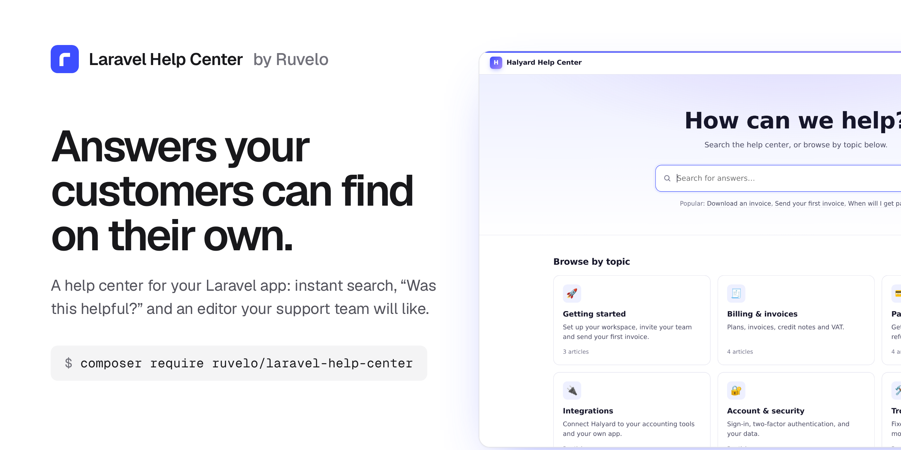
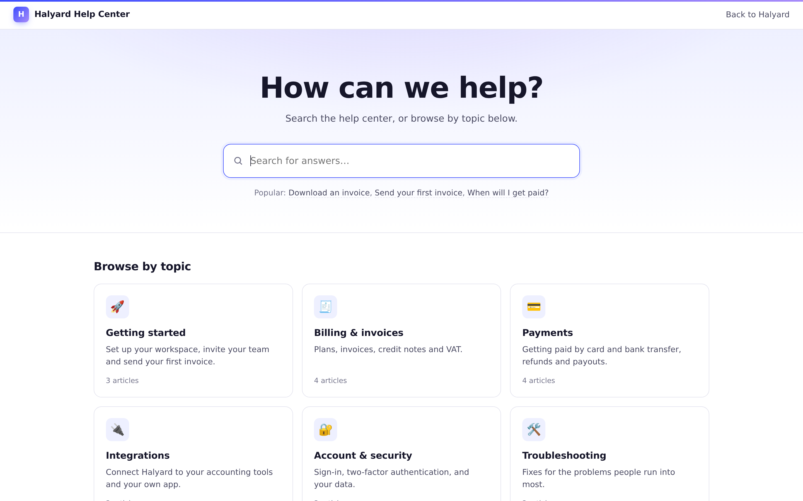
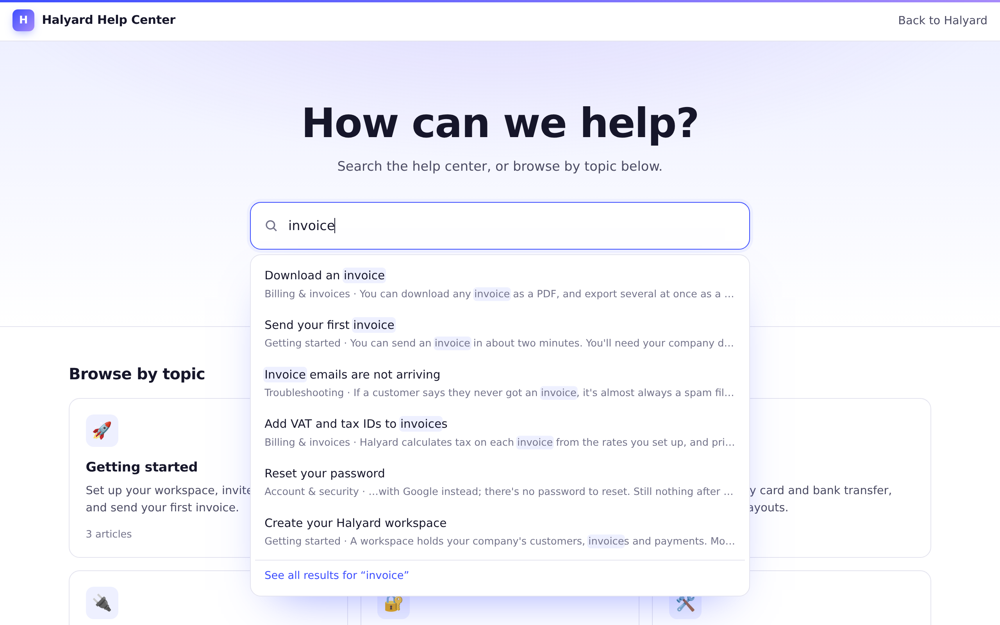
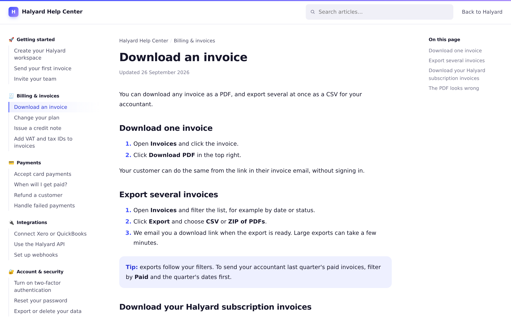
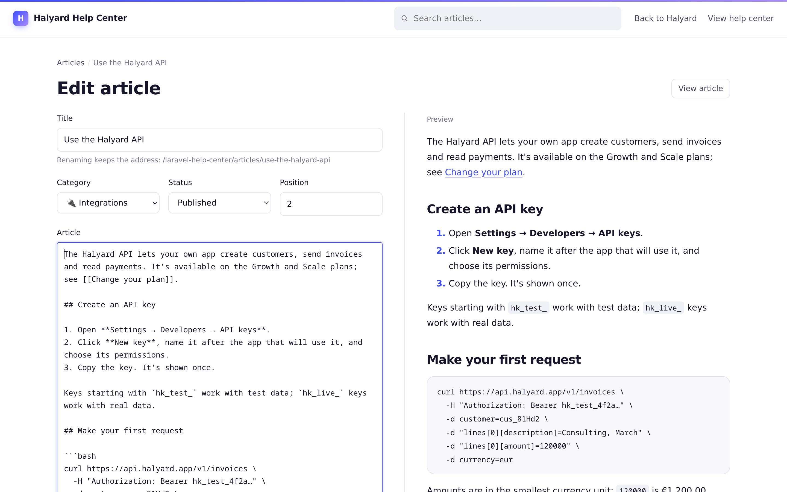
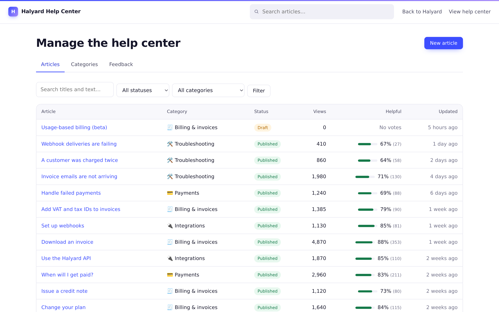
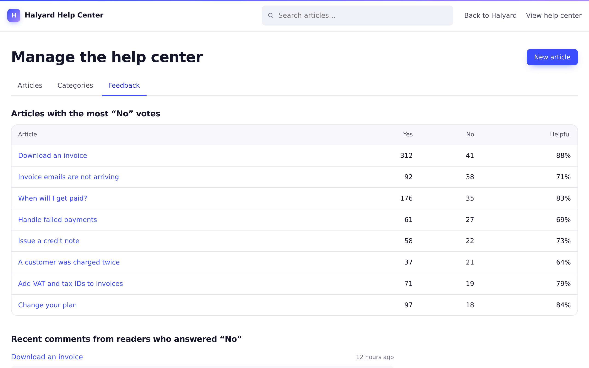
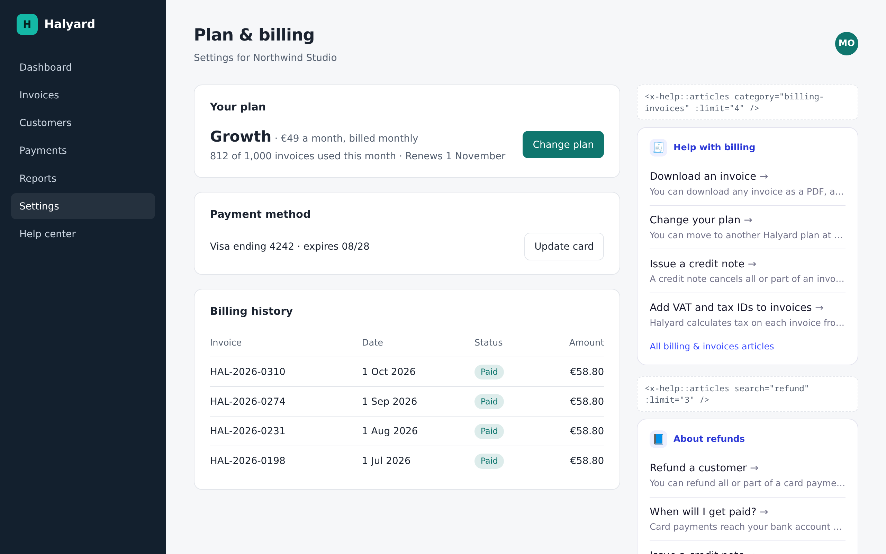
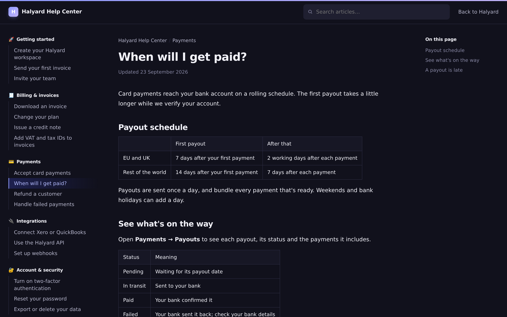

<p align="center">
  <a href="https://ruvelo.github.io/laravel-help-center/"></a>
</p>

<p align="center">
  <a href="https://ruvelo.github.io/laravel-help-center/"><strong>Live demo</strong></a> &nbsp;&nbsp;&nbsp;
  <a href="#configuration"><strong>Configuration</strong></a> &nbsp;&nbsp;&nbsp;
  <a href="#for-developers"><strong>Developer guide</strong></a> &nbsp;&nbsp;&nbsp;
  <a href="CHANGELOG.md"><strong>Changelog</strong></a>
</p>

<p align="center">
  <a href="https://github.com/Ruvelo/laravel-help-center/actions/workflows/tests.yml"></a>
  
  
  
  <a href="LICENSE"></a>
</p>

# Laravel Help Center

**A public help center for your Laravel app.** FAQ and knowledge base articles in categories, instant search, "Was this article helpful?", and an editor your support team will actually use. It runs on your database, with no frontend build step and no extra services.

```
composer require ruvelo/laravel-help-center
php artisan migrate
```

Then open `/help`, and [let your support team in](#who-can-edit) to write the first article. Or click around the [live demo](https://ruvelo.github.io/laravel-help-center/) first.

It's the customer-facing sibling of [ruvelo/laravel-wiki](https://github.com/Ruvelo/laravel-wiki), which is for your team.

## A quick tour



**Customers start with a question.** The home page is a search box and a card for each topic.



**Answers appear as they type.** Suggestions come from titles and article text, with the matching words highlighted. Press Enter for the full results; an exact title goes straight to the article.



**Articles read like good docs.** Categories and their articles on the left, the article in the middle, its outline on the right. Under each article: "Was this article helpful?", related articles and a "Still need help?" box.



**Write with a live preview.** Markdown on the left, the finished article on the right. Drafts stay private until you publish them.

<table>
  <tr>
    <td width="50%"></td>
    <td width="50%"></td>
  </tr>
  <tr>
    <td><strong>See what works:</strong> views and the share of readers who found each article helpful.</td>
    <td><strong>Hear what's missing:</strong> readers who answer "No" can say why.</td>
  </tr>
  <tr>
    <td width="50%"></td>
    <td width="50%"></td>
  </tr>
  <tr>
    <td><strong>Help where people get stuck:</strong> drop <code>&lt;x-help::articles&gt;</code> into any page of your app.</td>
    <td><strong>Light and dark</strong>, following each reader's system setting.</td>
  </tr>
</table>

## Features

- **Search that helps**: suggestions as you type, every word matched across titles and text, highlighted snippets, and an exact title jumps straight to the article. Without JavaScript it's an ordinary search form.
- **Categories** with an emoji icon, a description and their own order; **articles** with a title, a Markdown body, an excerpt, a status and a position in their category.
- **Docs-style articles**: a menu of categories on the left, breadcrumbs and "Updated 12 March 2026" above the article, an "On this page" outline on the right.
- **"Was this article helpful?"** One vote per visitor (remembered by session and cookie, or by account when signed in), an optional short comment after a "No", and it works without JavaScript.
- **Links between articles**: `[[Download an invoice]]`, `[[Download an invoice|this guide]]` or `[[Refunds#Timing]]`. Readers never hit a dead end: a link to an unpublished article shows as plain text to them, and in red to editors, opening the create form.
- **Stable addresses**: an article's URL is set once, so renaming it never breaks links or search results.
- **Drafts** that only editors see, and a publish step.
- **View counts** with one indexed update per read, skipping editors, bots and prefetches, and never touching the "Updated" date.
- **An editor area** at `/help/manage`: the article list with filters, views and helpful share; a side-by-side editor with live preview; categories you can create, rename, reorder and delete when empty; and readers' comments.
- **No lost edits**: if someone saves an article while you're editing it, your save is refused rather than overwriting theirs, and your text stays in the editor.
- **SEO**: sensible `<title>`s, meta descriptions from excerpts, canonical URLs, `noindex` on drafts and search, and a `sitemap.xml` of published articles.
- **Contextual help** in your own pages with a Blade component.
- **Import and export** folders of Markdown, with front matter.
- **A JSON API** for React, Vue and Inertia frontends, off by default.
- **Answers for AI agents**: an optional MCP server lets support teams' assistants and customer-facing chatbots search and quote your articles, and lets editors' agents draft them. Ships Laravel Boost guidelines too.
- **Safe to render**: raw HTML in articles is escaped and `javascript:` links are dropped.
- **Light and dark mode**, readable at phone width, and keyboard friendly.

## Requirements

- PHP 8.3+
- Laravel 12 or 13
- Any database Laravel supports (tested on SQLite; plain SQL that also suits MySQL, MariaDB and Postgres)
- Optional: [`laravel/mcp`](https://github.com/laravel/mcp) ^1.0 for the [MCP server](#use-it-from-ai-agents)

## Who can edit

**Anyone can read; no one can edit until you say who.** Define a `help-center-edit` gate, for example in your `AppServiceProvider`:

```php
use Illuminate\Support\Facades\Gate;

Gate::define('help-center-edit', fn ($user) => $user->is_support);
```

Guests who open `/help/manage` are sent to your `login` route, or get a 403 if your app has none. Editors see a **Manage** button in the header and an **Edit** link on every article.

To make the whole help center private, wrap every route in `auth` through the config:

```php
'middleware' => ['web', 'auth'],
```

## Configuration

Publish the config file if you want to change the defaults:

```
php artisan vendor:publish --tag=help-center-config
```

| Key | Default | |
|---|---|---|
| `name` | `Help Center` (`HELP_CENTER_NAME`) | Shown in the header, page titles and breadcrumbs |
| `path` | `help` (`HELP_CENTER_PATH`) | URL prefix |
| `domain` | `null` | Serve the help center on its own (sub)domain, like `help.example.com` |
| `middleware` | `['web']` | Applied to every route |
| `manage_middleware` | `[]` | Extra middleware for the editor (the gate is always checked) |
| `layout` | `null` | A view name to render inside your app's layout instead of the help center's own page |
| `section` | `content` | The section of your layout the help center fills |
| `contact.url` / `contact.email` | `null` (`HELP_CENTER_CONTACT_URL` / `_EMAIL`) | Where "Still need help?" sends people; with neither, the box is hidden |
| `contact.label` / `contact.text` | `Contact us`, one sentence | The box's button and line of text |
| `app.label` / `app.url` | `null` | A link back to your product in the header |
| `headline` | `How can we help?` | The home page heading |
| `popular` | `6` | Popular articles on the home page; `0` hides them |
| `feedback.per_minute` | `20` | Votes and comments per visitor per minute |
| `table_prefix` | `help_` | Tables are `{prefix}categories`, `{prefix}articles`, `{prefix}feedback` |
| `run_migrations` | `true` | Set to `false` if you publish and manage the migration yourself (`--tag=help-center-migrations`) |
| `per_page` | `20` | Page size for lists and search |
| `routes` | `true` | Set to `false` to register routes yourself (copy `routes/web.php`) |
| `api.enabled` | `false` (`HELP_CENTER_API`) | Turn on the JSON API |
| `api.prefix` | `api/help` | Where the JSON API lives |
| `api.middleware` | `['api']` | Applied to every API route; reads are public |
| `api.write_middleware` | `['auth:sanctum']` | Added to API writes, on top of the gate |
| `mcp.enabled` | `false` (`HELP_CENTER_MCP`) | Turn on the [MCP server](#use-it-from-ai-agents); needs `laravel/mcp` |
| `mcp.path` | `mcp/help` | The MCP endpoint; `null` for stdio only |
| `mcp.middleware` | `['api', 'auth:sanctum']` | Guards the endpoint. `['api', 'throttle:60,1']` makes it public (published articles only) |
| `mcp.local` | `false` | Also serve over stdio: `php artisan mcp:start help-center` |
| `mcp.allow_writes` | `false` (`HELP_CENTER_MCP_WRITES`) | Offer `write_article` to editors (the gate is always checked) |
| `mcp.server` | `HelpCenterServer::class` | Your subclass, to add tools of your own |
| `markdown.extensions` | `[]` | Extra CommonMark extensions |
| `markdown.options` | `[]` | CommonMark options, merged over the defaults |

## Making it look like your app

**Inside your layout.** Set `layout` to one of your views and the help center renders inside it, filling the section named by `section`:

```php
'layout' => 'layouts.app',   // resources/views/layouts/app.blade.php
'section' => 'content',      // where it calls @yield('content')
```

The help center's meta description, canonical link and `robots` tag are pushed to a `help-head` stack; add `@stack('help-head')` to your layout's `<head>` to keep them. The page title is in the `title` section if you want it. All styles are scoped under `.hc`, so nothing leaks into your pages.

**Colours.** Every colour is a CSS variable (`--help-accent`, `--help-bg`, `--help-ink` and friends), set on `.hc`. Override them in your own stylesheet.

**The views.** They're plain Blade. Publish them and edit as you like:

```
php artisan vendor:publish --tag=help-center-views
```

They land in `resources/views/vendor/help`. Styles live in `partials/styles.blade.php`; the small script that runs search suggestions and the feedback buttons is in `partials/scripts.blade.php`.

## Contextual help in your app

Show the right articles where people get stuck, like next to your billing settings:

```blade
<x-help::articles category="billing-invoices" :limit="5" />
<x-help::articles search="refund" title="Refunds, explained" />
```

`category` takes a slug or a name; `search` lists the best matches instead. It renders a compact list of published articles that link into the help center, with self-contained styles (every class starts with `hcw-`, included once per page). Pass `class` to add your own.

## Use it from AI agents

The help center can answer questions inside the AI tools people already use. Support agents can ask Claude, ChatGPT or Cursor "how do refunds work on annual plans?" and get the answer from your articles, with a link to send the customer. A chatbot on your site can do the same for customers.

It's an [MCP](https://modelcontextprotocol.io) server built on [`laravel/mcp`](https://laravel.com/docs/mcp), off by default:

```bash
composer require laravel/mcp
```

```ini
HELP_CENTER_MCP=true
```

Agents get these tools:

| Tool | Does |
|---|---|
| `search_articles` | `query` (plus optional `category` and `limit`, up to 20) → published matches with `title`, `slug`, `excerpt`, `category` and `url`, best first |
| `read_article` | `slug` → the article as `markdown`, with `title`, `category`, `url`, `version` and `updated_at` |
| `list_categories` | Every category with its `slug`, `description`, `url` and published `article_count` |
| `write_article` | Editors only, and only when `mcp.allow_writes` is on: create an article (a draft unless `status` is `published`) or change one by `slug` |

Every article is also a resource, `help-center://articles/{slug}`, in Markdown.

**Who sees what.** Drafts never reach anyone but editors (the `help-center-edit` gate). `search_articles` only ever returns published articles. `write_article` doesn't even appear in the tool list unless writes are allowed and the signed-in user passes the gate, and the gate is checked again on every call. It saves through `Article::commit()`, so every save is versioned and fires the usual events. Changing an article takes the `base_version` the agent read; if someone saved in between, nothing is saved and the agent is told to read the article again.

**Signing in.** The endpoint is `POST /mcp/help`, behind `['api', 'auth:sanctum']` by default: give each person or bot a [Sanctum](https://laravel.com/docs/sanctum) token. A public help center has nothing to hide, so you may open it to everyone and rate-limit it instead:

```php
// config/help-center.php
'mcp' => [
    'middleware' => ['api', 'throttle:60,1'],
    // ...
],
```

Laravel MCP can also do OAuth through Passport; see [its docs](https://laravel.com/docs/mcp#authentication).

**Connecting a client.** Most clients take a URL and a header. For Claude Code:

```bash
claude mcp add --transport http help https://example.com/mcp/help --header "Authorization: Bearer <your token>"
```

For clients configured with JSON, such as Cursor (`.cursor/mcp.json`) or VS Code (`.vscode/mcp.json`, which calls the key `servers`):

```json
{
    "mcpServers": {
        "help": {
            "url": "https://example.com/mcp/help",
            "headers": { "Authorization": "Bearer <your token>" }
        }
    }
}
```

On your own machine you can skip HTTP: set `mcp.local` to `true` and point the client at Artisan. Over stdio no one is signed in, so it's read-only and shows published articles only.

```json
{
    "mcpServers": {
        "help": { "command": "php", "args": ["artisan", "mcp:start", "help-center"] }
    }
}
```

Try it with the inspector: `php artisan mcp:inspector mcp/help`.

**A support chatbot with the Laravel AI SDK.** Agents built with [`laravel/ai`](https://laravel.com/docs/ai-sdk) accept Laravel MCP tools as they are, so you can ground a chatbot on the help center without running the server at all:

```php
namespace App\Ai\Agents;

use Laravel\Ai\Contracts\Agent;
use Laravel\Ai\Contracts\HasTools;
use Laravel\Ai\Promptable;
use Ruvelo\HelpCenter\Mcp\Tools\ListCategories;
use Ruvelo\HelpCenter\Mcp\Tools\ReadArticle;
use Ruvelo\HelpCenter\Mcp\Tools\SearchArticles;

class SupportBot implements Agent, HasTools
{
    use Promptable;

    public function instructions(): string
    {
        return 'You answer questions about Halyard. Search the help center first, read the best article, '
            .'and answer in two or three sentences with its URL. If no article covers it, say so and '
            .'suggest contacting support. Never guess.';
    }

    public function tools(): iterable
    {
        return [new SearchArticles, new ReadArticle, new ListCategories];
    }
}
```

```php
$reply = (new SupportBot)->prompt('Can I get a refund on an annual plan?');
```

The tools see whoever is signed in, so a customer only ever gets published articles. Don't give `WriteArticle` to a customer-facing agent.

**Your own tools.** Extend `Ruvelo\HelpCenter\Mcp\HelpCenterServer`, add to its `$tools`, and set `mcp.server` to your class.

### Laravel Boost

The package ships [Laravel Boost](https://laravel.com/docs/boost) guidelines in `resources/boost/guidelines/core.blade.php`. Run `php artisan boost:install` (or `boost:update --discover`) and your coding agent learns the `HelpCenter` API, the write path, events, the Blade component, the import commands and what to avoid.

## For developers

### PHP API

```php
use Ruvelo\HelpCenter\HelpCenter;

HelpCenter::category('Billing & invoices', icon: '🧾', description: 'Plans, invoices and VAT.');

$article = HelpCenter::publish('Download an invoice', $markdown, 'billing-invoices'); // create or update, and publish
HelpCenter::write('Usage-based billing', $markdown, 'billing-invoices');            // create or update; new ones are drafts

HelpCenter::article('download-an-invoice')?->html();   // published only; pass drafts: true for drafts
HelpCenter::search('refund')->limit(5)->get();          // a query builder of published matches
HelpCenter::categories();                               // in order, with published_articles_count
HelpCenter::render('**Markdown** with [[links]]');

// One write path: refuse the save if someone else saved since version 4.
$article->commit(['body' => $markdown, 'status' => 'published'], basedOn: 4);
```

`Article::commit()` and `Category::commit()` are the only ways content changes, so every change fires its events. `Category::move(-1)` and `remove()` reorder and delete (only when empty).

**Events**: `ArticleUpdated` (every save, with `$created` and the `$changed` attributes), `ArticlePublished` (when an article goes live), `ArticleDeleted`, `FeedbackReceived` (a vote, and again with `$commented` when a comment follows), `CategorySaved` and `CategoryDeleted`.

**Exceptions**, all extending `HelpCenterException`: `InvalidTitle`, `InvalidStatus`, `ArticleAlreadyExists`, `CategoryAlreadyExists`, `CategoryNotFound`, `CategoryNotEmpty` and `EditConflict`.

### JSON API

Off by default. Set `HELP_CENTER_API=true` and you get these under `/api/help`. Reads return published content only and need no sign-in; writes need `api.write_middleware` (Sanctum by default) and the `help-center-edit` gate.

| Request | Does |
|---|---|
| `GET /categories` | Every category, in order, with `article_count` |
| `GET /categories/{slug}` | One category with its published `articles` |
| `GET /articles?category=` | Published articles in menu order, optionally in one category. Paginated, `per_page` up to 100 |
| `GET /articles/{slug}` | One article with `body`, `html`, `outline` and `version` |
| `GET /search?q=` | Published matches with a highlighted `snippet_html` |
| `POST /articles` | Create from `title`, `body`, `category` (slug), `status`, `excerpt`, `position`. `201`, or `409` if the title is taken |
| `PATCH /articles/{slug}` | Change any of those; send `base_version` to get a `409` instead of overwriting a newer save |
| `DELETE /articles/{slug}` | Delete the article and its feedback. `204` |
| `POST /categories`, `PATCH /categories/{slug}` | Create or change a category (`name`, `icon`, `description`, `position`) |
| `DELETE /categories/{slug}` | Delete an empty category; `409` while it has articles |

The help center's own search box also uses `GET /help/search/suggest?q=`, which is always on and returns `title_html`, `snippet_html`, `category` and `url` for up to six articles. It's a good fit for a search box in a React, Vue or Inertia page. Votes go to `POST /help/articles/{slug}/feedback` with `helpful` (and optionally `comment`); send `Accept: application/json` to get `{"state": "yes" | "no" | "done"}` back.

### Import and export

```bash
php artisan help:import docs/help --status=published   # folders are categories
php artisan help:export storage/help                    # the same layout, back out
```

Each sub-folder is a category; an optional `_category.md` in it sets `name`, `icon` and `position` in front matter, and the description as its body. Articles take `title`, `slug`, `category`, `status`, `position` and `excerpt` from front matter (a leading `# Heading` or the file name work for the title too). Re-importing only saves what changed, and `--dry-run` shows what would.

```markdown
---
title: Download an invoice
status: published
position: 1
---

You can download any invoice as a PDF…
```

### Extending Markdown

```php
// config/help-center.php: 'markdown' => ['extensions' => [FootnoteExtension::class]]
HelpCenter::extendMarkdown(fn (Environment $env) => $env->addExtension(new AttributesExtension));
```

### In your tests

```php
Article::factory()->create();                                     // published, in a new category
Article::factory()->draft()->for(Category::factory()->named('Billing'))->create();
Article::factory()->uncategorised()->titled('Reset your password')->create();
```

## URLs

| | |
|---|---|
| `/help` | Home: search, categories, popular articles |
| `/help/categories/{slug}` | A category's articles |
| `/help/articles/{slug}` | An article |
| `/help/search?q=` | Search (`&all=1` to skip the jump to an exact title) |
| `/help/sitemap.xml` | Every published article, for search engines |
| `/help/manage` | Articles, for editors |
| `/help/manage/articles/new` | Write an article (`?title=` and `?category=` to pre-fill) |
| `/help/manage/categories` | Categories |
| `/help/manage/feedback` | What readers said (`?article=` for one article) |

## Contributing

Pull requests are welcome. Clone, `composer install`, then `composer check` runs code style (Pint), static analysis (PHPStan level 8) and the tests, exactly as CI does. See [CONTRIBUTING.md](CONTRIBUTING.md) and the [changelog](CHANGELOG.md).

The demo and screenshots are built from the package itself: `composer demo` writes the static demo into `build/`, and `demo/screenshots.sh` regenerates `art/`.

## Credits

Built by [François Bultez](https://github.com/francoisbultez) at [Valtry](https://valtry.co.uk/?utm_source=ruvelo&utm_medium=github&utm_campaign=laravel-help-center), the website security scanner, and everyone who [contributes](https://github.com/Ruvelo/laravel-help-center/graphs/contributors).

## License

MIT. See [LICENSE](LICENSE).
